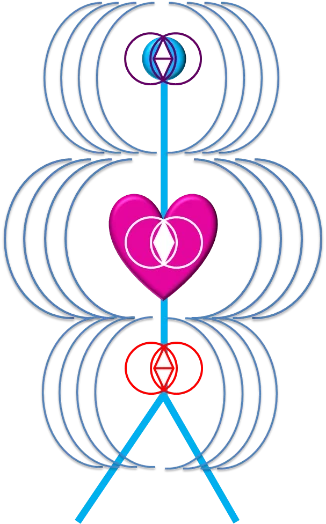
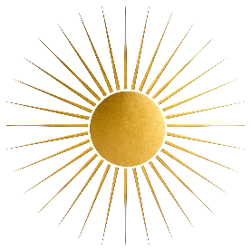
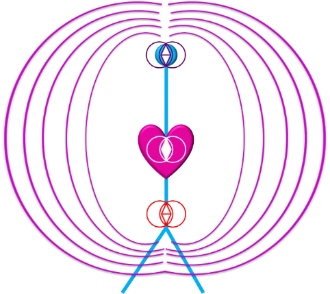
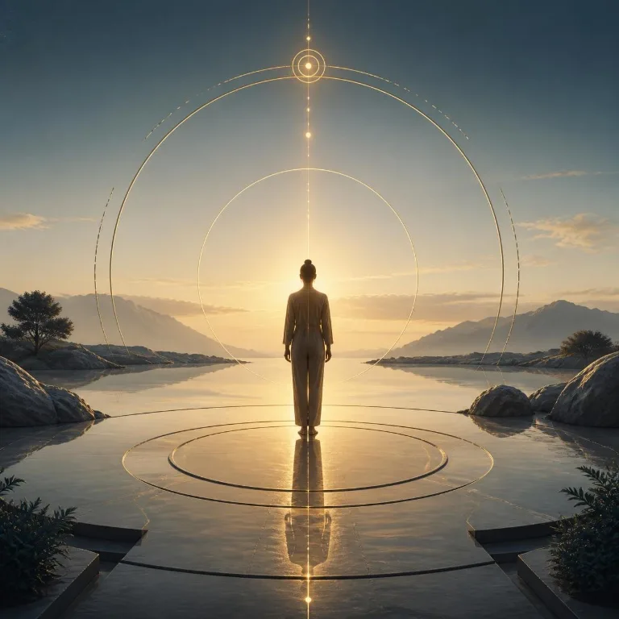

Nous avons 3 grands centres énergétiques qui sont aussi des corps énergétiques intérieurs qui nous permettent de faire circuler notre énergie dans notre corps.

Ainsi, c’est votre vibration, votre fréquence qui s’émane et se pose autour de vous lorsque vous les unissez.

<figure class="illustration illustration--droite"></figure>

Vous pouvez moduler vos fréquences, harmoniser votre énergie intérieure, augmenter votre Lumière intérieure en activant votre Soleil Intérieur.

Vous réactivez pleinement vos corps énergétiques et vous les nettoyez, les purifiez grâce à la Lumière Dorée de votre Soleil. Vous pouvez tout transmuter sur le plan éthérique et énergétique !

Ainsi, vous commencez à élever votre fréquence et à vivre des émotions beaucoup plus positives !

***Les 3 centres et corps :***

  

    <h3>Le Centre du Mental</h3>
    
Le Corps mental

    
Il génère du nouveau : <mark class="a-trancher">nouvelles connexions neuronales</mark>, nouvelles façons de penser, nouvelles croyances non limitantes, positives, nouvelles façons d’agir, nouveaux comportements.

  

  

    <h3>Le Centre du Cœur</h3>
    
Le Corps émotionnel

    
Il contient les émotions d’ici et maintenant, les mémoires émotionnelles, transgénérationnelles, blessures d’incarnation. <mark class="a-trancher">Il gère le sang, la respiration</mark>, la libération et transformation et la nouvelle façon de ressentir.

  

  

    <h3>Le Centre Créateur</h3>
    
Le Corps Créateur

    
C’est le centre où tout ce que l’on crée se manifeste.

    
Équilibre entre les forces Féminines et Masculines.

    
C’est là que se pose le pouvoir créateur, la Force de Vie Créatrice ainsi que la Souveraineté !

  

<strong>À trancher avec Moz</strong> — Deux affirmations sur le corps, que la ligne du site évite (on décrit ce que la personne vit, pas ce que ça produit dans le corps) : « nouvelles connexions neuronales » (déjà relevé dans la version précédente) et « Il gère le sang, la respiration ».

Lorsque vous libérez ces 3 centres et corps, vous commencez à réellement transformer votre vie.

Vos 3 centres montent en énergie et en fréquence et cela permet de remplir tous les corps énergétiques. Vous créez des émotions positives.

À ce moment, votre fréquence et votre Lumière intérieure sont les plus élevées possibles !

Vous pouvez vous aider de la respiration qui est essentielle pour entrer à l’intérieur de soi ! Mais avant de commencer :

***Posez une intention claire avant de procéder !***

<section class="pratique-guidee" aria-labelledby="titre-pratique">
  <h2 id="titre-pratique">Pratique : la Respiration Conscience du Souffle Créateur</h2>

  
La respiration permet l’ancrage. Le va-et-vient du souffle crée le mouvement. L’inspire et l’expire ont une valeur de recevoir et de donner… Cela permet de ressentir la Vie revenir en soi.

  
La Respiration Conscience permet d’avoir une pleine conscience de ce mouvement intérieur, du vide de l’expiration au plein de l’inspiration… Laissez entrer la Lumière Dorée de votre Soleil Intérieur et sortir ce qui n’est plus en accord avec vous… La Lumière Dorée de votre Soleil Intérieur est alchimique, elle vous permet de transmuter…

  
Laissez être la fluidité, et lâchez prise… sans quoi, vous créez de la résistance <mark class="a-trancher">ce qui crée de la douleur</mark>… laissez tout cela partir !

  
<strong>À trancher avec Moz</strong> — « ce qui crée de la douleur » : effet sur le corps. Peut-être « de la tension », « une crispation » ?

  <figure class="illustration illustration--droite illustration--petite"></figure>
  
Inspirez la Lumière Dorée de votre Soleil Intérieur et expirez ce qui n’est plus en accord avec votre Lumière.

  
Vous vous connectez à votre Soleil Intérieur dans le Plexus Solaire.

  
Prenez une profonde respiration pour déployer votre Lumière et votre Soleil… Il se manifeste devant vous…

  
<strong>Puis, vous inspirez, absorbez, intégrez, émanez et rayonnez…</strong>

  
Lorsque vous inspirez la Lumière Dorée de votre Soleil Intérieur, vous la recevez dans le centre énergétique de votre choix, ce qui va l’ouvrir…

  
Puis, vous inspirez et absorbez la Lumière Dorée de votre Soleil Intérieur. Vous l’intégrez en vous et vous activez votre centre énergétique…

  
Ensuite, vous inspirez pour l’amplifier à l’intérieur de vous. La Lumière Dorée de votre Soleil Intérieur s’émane à l’intérieur de vous, dans toutes vos cellules, dans tous vos atomes, dans chacun de vos organes, de vos muscles, de vos os…

  
Chaque inspiration permet de faire circuler la Force de Vie Créatrice de bas en haut et de haut en bas.

  <figure class="illustration illustration--moyenne"></figure>
  
Inspirez profondément la Lumière Dorée de votre Soleil Intérieur… Laissez-la émaner de chacun de vos 3 centres… Posez votre intention d’unité…

  
Et ressentez que ces 3 centres s’unifient en un seul…

  
Inspirez profondément, rayonnez, irradiez tout autour de vous cette Lumière Dorée de votre Soleil Intérieur !

  
Plus votre unité se crée, plus votre fréquence est élevée et plus vous l’émettez autour de vous !

  
Bravo, vous êtes en train d’harmoniser vos 3 centres et corps énergétiques. Vous émettez une fréquence élevée et positive, vous allez attirer à vous ce qui est en concordance avec, votre vie devient plus élevée et en accord avec qui vous êtes !

  
À refaire autant que nécessaire et dès que vous sentez que vous avez des crispations, des blocages ou que vous êtes dans des fréquences ou émotions basses !

</section>

Belles fréquences à chacun de vous !

<figure class="illustration illustration--large"></figure>
